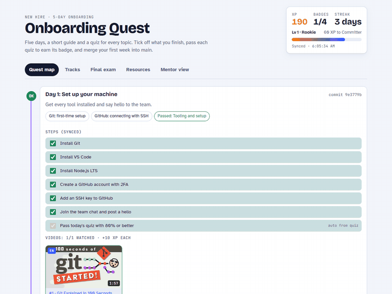
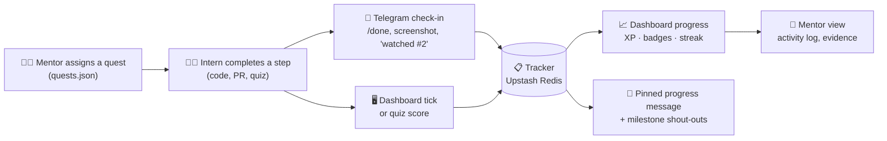
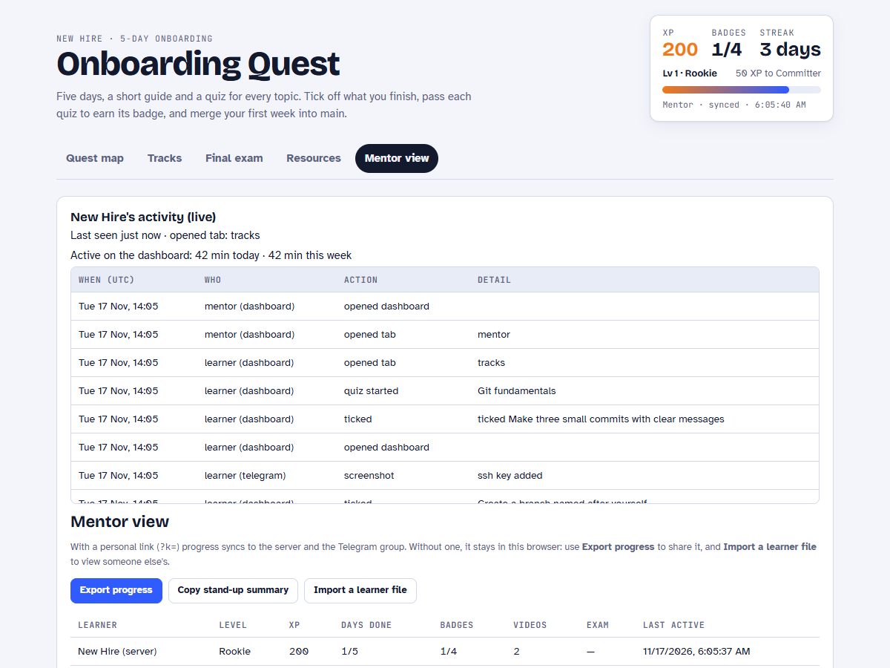
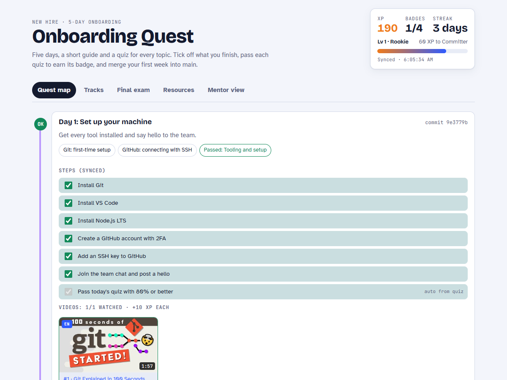

<div align="center">

# 🧭 Onboarding Quest

**Turn a new hire's first week into a game they actually finish.**

A quest map, quizzes, badges, XP and streaks for the learner, a Telegram mentor bot for daily check-ins, and live progress for the team lead. One JSON file defines the whole track.

[](https://github.com/Shadysmetools/onboarding-quest/actions/workflows/ci.yml)
[](LICENSE)


⭐ **If this saves you an onboarding week, give it a star. It helps other team leads find it.**

[](https://vercel.com/new/clone?repository-url=https%3A%2F%2Fgithub.com%2FShadysmetools%2Fonboarding-quest&env=PROGRESS_KEY,ADMIN_KEY,WEBHOOK_SECRET&envDescription=Random%20strings%20for%20the%20learner%20link%2C%20the%20mentor%20link%20and%20the%20Telegram%20webhook&envLink=https%3A%2F%2Fgithub.com%2FShadysmetools%2Fonboarding-quest%23environment-variables&project-name=onboarding-quest)



</div>

> The demo above runs locally with `npm run demo` and the sample quest only. No real learner data.

## Why

Most onboarding is a wiki page and a "ping me if you're stuck". New hires don't know what "done" looks like, mentors don't know who is stuck, and week 1 drifts into week 3.

Onboarding Quest gives the week a shape:

- **The learner** gets one clear next step, short guides, a quiz per topic and visible progress (XP, levels, badges, streaks, confetti).
- **The mentor** gets a live view of what was done and when, screenshot evidence from Telegram, and a pinned progress message in the team chat that updates itself.
- **The team lead** writes the track once as JSON and reuses it for every new hire.

## How it works



Every change goes through the same API (`/api/progress` from the dashboard, `/api/telegram` from the bot), lands in one Redis hash per field, and is reflected everywhere: the dashboard polls, the bot edits its pinned message, and milestones (day complete, quiz passed, exam passed) are announced once.

## Features

| | |
|---|---|
| 🗺️ **Quest map** | Each day is a commit on a feature branch that merges into `main` when the week is done. Steps, guides, videos and quizzes per day. |
| 🧠 **Quizzes and a final exam** | Multiple choice with explanations. Pass mark is configurable. The final exam draws random questions from every quiz. |
| 🏅 **Gamification** | XP, levels, track badges, a daily streak, and confetti that respects `prefers-reduced-motion`. |
| 🤖 **Telegram mentor bot** | `/next`, `/progress`, `/done` with tap-to-tick buttons. Send a screenshot and it is saved as evidence on the matching step. `watched #3` ticks a video. |
| 📌 **Live pinned progress** | One message in the group, edited in place on every change. No spam. |
| 👀 **Mentor view** | Last seen, active minutes per day, and a full activity log (dashboard and Telegram). |
| 🔑 **Simple access model** | A learner link (`?k=PROGRESS_KEY`) and a mentor link (`?k=ADMIN_KEY`). Everyone else gets a read-only view. |
| 📋 **Tracker export** | Optional: mirror the quest into GitHub Issues, a milestone and a Project board, or a CSV for ClickUp, Jira, Linear and others. |
| 🪶 **Zero dependencies** | Plain Node.js and one HTML file. Runs locally with no accounts at all. |

<p align="center"></p>

## Quickstart

### Run it locally (2 minutes)

You need [Node.js](https://nodejs.org) 20.12 or newer. Nothing else.

```bash
git clone https://github.com/Shadysmetools/onboarding-quest.git
cd onboarding-quest

# Option A: instant demo with sample progress (in memory, nothing is saved)
npm run demo
# open http://localhost:3000/?k=demo-learner        (learner)
# open http://localhost:3000/?k=demo-mentor#mentor  (mentor)

# Option B: your own local instance (progress saved to .data/store.json)
cp .env.example .env          # Windows PowerShell: Copy-Item .env.example .env
npm run dev
# open http://localhost:3000/?k=change-me-learner-key
```

The `?k=` key is remembered by the browser and removed from the address bar, so the learner only opens the link once.

<p align="center"></p>

### Make your own quest

```bash
cp quests.example.json quests.json   # edit days, steps, quizzes, videos, tracks
npm run build                        # validates it and regenerates the dashboard data
npm run dev
```

`npm run build` fails with a list of every problem if the file is inconsistent (an unknown quiz id, an answer index out of range, and so on). Commit `quests.json`: the build uses it instead of the example when it exists.

<details>
<summary><b>Quest file reference</b></summary>

```jsonc
{
  "title": "Onboarding Quest",          // page title
  "learner": "New Hire",               // shown in the bot and the mentor view
  "tagline": "…",
  "passMark": 0.8,                     // quiz pass ratio
  "levels": [{ "at": 0, "name": "Rookie" }, { "at": 250, "name": "Committer" }],
  "exam": { "name": "Final exam", "count": 10, "pass": 8 },   // or false
  "finale": "Week 1 complete. Your first real ticket is next!",
  "days": [{
    "n": 1, "title": "Set up your machine", "summary": "…",
    "steps": ["Install Git", "Add an SSH key to GitHub"],     // checkable steps
    "docs": [{ "title": "Git: first-time setup", "url": "https://…" }],
    "videos": ["git-100"],          // ids from "videos"
    "quizzes": ["setup"]            // adds an automatic "pass today's quiz" step
  }],
  "videos": [{ "id": "git-100", "title": "…", "url": "https://www.youtube.com/watch?v=…",
               "channel": "…", "len": "1:57", "lang": "EN", "track": "git" }],
  "tracks": [{ "key": "git", "name": "Git & GitHub", "short": "GIT", "quizzes": ["git", "pr"] }],
  "resources": [{ "group": "Learn Git", "name": "owner/repo", "what": "…", "level": "Beginner", "url": "https://…" }],
  "quizzes": { "git": { "topic": "Git fundamentals", "questions": [
    { "q": "…?", "options": ["a", "b", "c", "d"], "answer": 3, "explain": "…" }
  ] } }
}
```

XP: 10 per step, 10 per video, 5 per correct quiz answer (best attempt) plus 50 for a pass, 200 for passing the final exam.
</details>

### Deploy to Vercel

1. Click **Deploy with Vercel** above (or import your fork at [vercel.com/new](https://vercel.com/new)). Set `PROGRESS_KEY`, `ADMIN_KEY` and `WEBHOOK_SECRET` to long random strings:
   ```bash
   node -e "console.log(crypto.randomUUID())"
   ```
2. Add storage (see [Upstash setup](#upstash-setup)). Without it, progress cannot be saved on Vercel.
3. Redeploy so the new variables are picked up.
4. Send the learner `https://<your-deployment>/?k=<PROGRESS_KEY>` and keep `?k=<ADMIN_KEY>` for mentors.

Vercel runs `npm run build` (set in `vercel.json`), serves `public/` and turns each `api/*.mjs` file into a function.

### Upstash setup

Progress lives in [Upstash Redis](https://upstash.com) through its REST API. The free tier is plenty for this.

**Through Vercel (easiest):** Project → **Storage** → **Create Database** → **Upstash for Redis** → connect it to the project. Vercel adds `KV_REST_API_URL` and `KV_REST_API_TOKEN` for you.

**Directly:** create a database in the [Upstash console](https://console.upstash.com), open its **REST API** section, and copy the URL and token into `KV_REST_API_URL` and `KV_REST_API_TOKEN` (the `UPSTASH_REDIS_REST_URL` / `UPSTASH_REDIS_REST_TOKEN` names work too).

All keys are prefixed with `KEY_PREFIX` (default `oq:`), so one database can host several quests: deploy once per new hire with a different prefix.

### Telegram bot setup

The bot is optional. Without it the dashboard works on its own.

1. **Create the bot.** In Telegram, message [@BotFather](https://t.me/BotFather), send `/newbot`, and copy the token into `TELEGRAM_BOT_TOKEN`.
2. **Let it read the group.** In BotFather send `/setprivacy`, pick your bot, choose **Disable**. (Or make the bot an admin.) Without this it can't see "installed VS Code" or "watched #2" messages.
3. **Create a group** with the learner and the mentors, and add the bot. Make the bot an **admin** with permission to pin messages. Optional: turn on **Topics** and create an "Updates" topic for the pinned progress and a "Humans only" topic where the bot stays quiet.
4. **Find the ids.** Send a message in the group, then run locally (with the token in `.env`):
   ```bash
   npm run telegram:webhook -- whoami
   ```
   It lists the group (`chat -100…` → `TELEGRAM_CHAT_ID`), each user id (learner → `LEARNER_TELEGRAM_ID`, mentors → `TELEGRAM_ALLOWED_IDS`) and topic ids (→ `TELEGRAM_TOPICS`, for example `{"updates": 2, "humans": 3}`).
5. **Add those variables on Vercel** together with `DASHBOARD_URL=https://<your-deployment>`, and redeploy.
6. **Connect the webhook.** With the same `TELEGRAM_BOT_TOKEN`, `WEBHOOK_SECRET` and `DASHBOARD_URL` in your local `.env`:
   ```bash
   npm run telegram:webhook -- on      # also sets the /next /progress /done /help menu
   npm run telegram:webhook -- info    # check: webhook url, pending updates, last error
   ```

Then try `/next` in the group.

| The learner sends | The bot does |
|---|---|
| `/next` | Replies with the next open step |
| `/progress` | Today's checklist |
| `/done` | Buttons to tick today's steps |
| A screenshot with a caption like "ssh key added" | Ticks the matching step and saves the screenshot as evidence (or asks which step) |
| `watched #2 #3` | Marks those videos as watched |
| "installed", "done", "finished" | Offers the tick buttons |

### Optional: mirror the quest into a tracker

```bash
# GitHub: labels, a milestone, one issue per day (steps as a checklist), a Project board
gh auth login && gh auth refresh -s project
npm run tracker:github -- --owner <org-or-user> --repo <repo> --assignee <github-user> --start 2026-01-05 --dry-run
# drop --dry-run to create them. Safe to re-run.

# CSV for ClickUp, Jira, Linear, Asana or a spreadsheet
npm run tracker:csv -- --start 2026-01-05     # writes tracker/tasks.csv
```

## Environment variables

| Variable | Required | What it does |
|---|---|---|
| `PROGRESS_KEY` | Yes | Learner key. `/?k=PROGRESS_KEY` can tick steps and save quiz scores. |
| `ADMIN_KEY` | Yes | Mentor key. Can do everything the learner can, plus the activity log. |
| `KV_REST_API_URL` | On Vercel | Upstash Redis REST URL. Locally, leave empty to use `.data/store.json`. |
| `KV_REST_API_TOKEN` | On Vercel | Upstash Redis REST token. |
| `KEY_PREFIX` | No | Prefix for every Redis key. Default `oq:`. |
| `TELEGRAM_BOT_TOKEN` | For the bot | From @BotFather. |
| `TELEGRAM_CHAT_ID` | For the bot | The group id (negative number). |
| `LEARNER_TELEGRAM_ID` | For the bot | The learner's numeric user id. |
| `TELEGRAM_ALLOWED_IDS` | For the bot | Mentor user ids allowed to tick steps, comma separated. |
| `TELEGRAM_TOPICS` | No | `{"updates": <id>, "humans": <id>}` for forum groups. |
| `WEBHOOK_SECRET` | For the bot | Random string. Telegram sends it with every webhook call. |
| `DASHBOARD_URL` | For the bot | Public URL of your deployment, used in bot replies and to register the webhook. |
| `TIMEZONE` | No | IANA timezone for streaks and the activity log. Default `UTC`. |
| `PORT` | No | Local dev port. Default `3000`. |

## Project layout

```
quests.example.json   the sample quest (copy to quests.json)
public/index.html     the dashboard: one file, no build tools
api/                  Vercel functions: progress, telegram, activity, file
lib/compile.mjs       quest validation and compilation
server.mjs            local dev server running the same api/ handlers
scripts/              build, lint, demo seed, Telegram webhook helper
tracker/              GitHub Issues and CSV export
test/                 node:test suite
```

## Development

```bash
npm run build   # quest file -> api/_quest.json + data inlined in public/index.html
npm run lint    # syntax check, quest validation, build-output drift check
npm test        # API and quest logic tests against the in-memory store
```

See [CONTRIBUTING.md](CONTRIBUTING.md).

## Security notes

- The keys are shared secrets in a URL: fine for one learner and a few mentors, not a replacement for real auth. Use long random values and rotate them by changing the env vars.
- Reading progress is public on purpose (anyone with the dashboard URL sees the quest map). Don't put anything sensitive in the quest file.
- Screenshots are never stored by the app. The dashboard streams them from Telegram, only for keyed users.

## License & commercial use

Licensed under the [Apache License 2.0](LICENSE). See [NOTICE](NOTICE).

**Free for commercial use.** Use it for your company's onboarding, your bootcamp or your client projects, modify it, and ship it. Keep the license and notice files.

Want a custom setup (your own tracks and quizzes, SSO, Slack instead of Telegram, multi-learner cohorts) or help rolling it out to your team? Get in touch through the [maintainer's GitHub profile](https://github.com/Shadysmetools).

---

<p align="center">Built with care by Shady Al-Halawani. If it helped, a ⭐ goes a long way.</p>

---

**Built by [Shady Al-Halawani](https://github.com/Shadysmetools)**, AI Product Manager & Tech Lead · [LinkedIn](https://www.linkedin.com/in/shady-al-halawani-333a5419a) · [Book a call](https://calendly.com/shady-al-halawani)
